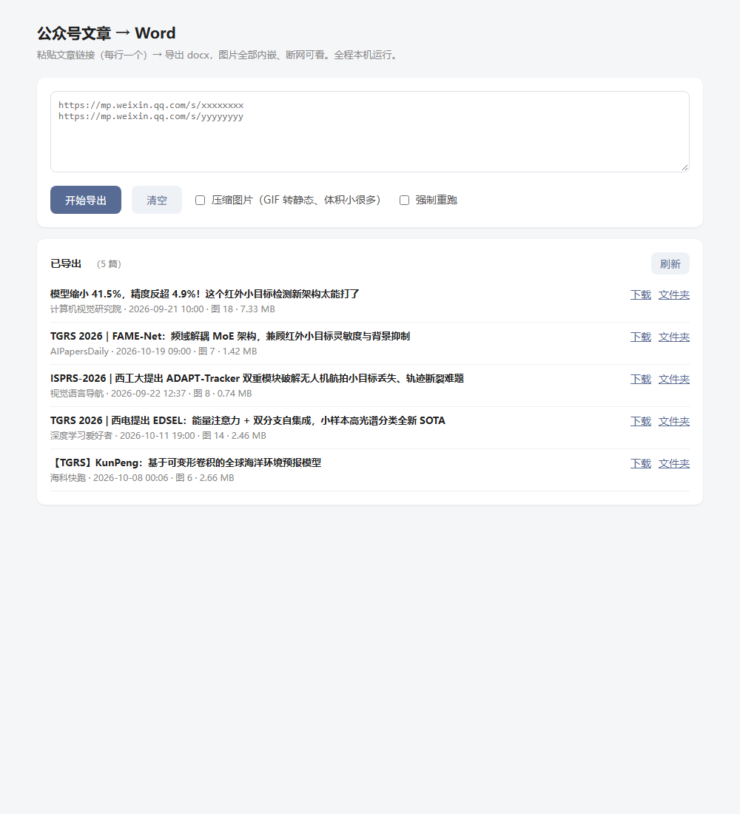

# wechat-article-to-word（W2D）

> **把公众号文章抓下来，存成一个「打开就是原文样子」的 Word。**
> 当前状态：**M1 已跑通** —— `w2d export <url>` 能出 docx，图片全部内嵌、标题层级可导航。
> 已用两篇真实文章验证：6/6 与 13/13 张图片全部内嵌，OOXML 结构合法（见 [06-M1记录](./docs/06-M1记录.md)）

---

## 快速开始

### 方式一：双击打开工作台（推荐）

双击项目根目录的 **`启动工作台.bat`**，浏览器会自动打开 `http://127.0.0.1:8865`：

1. 把文章链接粘进输入框（每行一个）
2. 需要小体积就勾「压缩图片」
3. 点「开始导出」，等进度跑完 → 点「下载 Word」



也可以用命令行启动：`.\.venv\Scripts\w2d.exe serve --port 8865`

### 方式二：命令行

```powershell
# 单篇
.\.venv\Scripts\w2d.exe export "https://mp.weixin.qq.com/s/xxxxxxxx"

# 多篇（同一命令跟多个 URL 即可）
.\.venv\Scripts\w2d.exe export "URL1" "URL2" -o output

# 批量：每行一个 URL（支持 # 注释）
.\.venv\Scripts\w2d.exe export --url-file urls.txt -o output

# 压缩图片（GIF 转静态图 / PNG→JPEG / 长边限制），大文件必备
.\.venv\Scripts\w2d.exe export "URL" --compress --max-edge 1600

# 只出 Word
.\.venv\Scripts\w2d.exe export "URL" --formats docx

# 强制重跑（默认同一篇文章已有完整产物就跳过）
.\.venv\Scripts\w2d.exe export "URL" --force

# 抓不到时用浏览器另存的 HTML 兜底
.\.venv\Scripts\w2d.exe export --input-html saved.html --source-url "URL"

# 从合集/列表页提取文章链接，再喂给 --url-file
.\.venv\Scripts\w2d.exe links "https://mp.weixin.qq.com/mp/appmsgalbum?..." -o urls.txt

# 关掉背景图卡片截图（默认开）
.\.venv\Scripts\w2d.exe export "URL" --no-screenshot

# 机器可读输出
.\.venv\Scripts\w2d.exe export "URL" --json
```

产物结构：

```
output/<标题>_<日期>_<短哈希>/
├─ article.docx        主交付物（图片内嵌、Heading 层级、彩色文字、页脚页码）
├─ article.html        离线单文件（图片 base64），作为保真参照物
├─ article.json        Article 模型，便于二次加工
├─ assets/img_001.png  本地化后的图片
└─ manifest.json       来源、HTML 哈希、每个产物 sha256、图片清单、耗时、告警
```

> 从零开始装：`uv python install 3.12` → `uv venv .venv --python 3.12` →
> `uv pip install --python .venv\Scripts\python.exe -e .`（`uv` 已在本机，无需管理员）

---

## 这个工具要解决什么

你想保存一篇公众号文章，现实是：
- 微信里"收藏"只能看不能导出；
- 网页 Ctrl+S 存下来是一堆 `_files` 和 html，给同事/打印时排版全乱；
- 复制粘贴进 Word，图片全变成外链，过几天全是红叉；
- 现有的开源下载器只给你 HTML/Markdown/PDF，**Word 永远是"顺带导出的第 N 种格式"，排版一次比一次离谱**。

所以这个工具的定位很窄、但很确定：**输入一篇公开可访问的公众号文章，输出一个文字完整、图片内嵌、版面基本还原、还能继续编辑的 `.docx`。**

---

## 能力边界（先说清楚，避免预期落差）

### ✅ 能做
- 单篇文章 URL → docx / html / json（CLI 已跑通）
- 多篇 URL 批量（CLI 已支持，串行 + 单篇失败不影响其他）
- 每篇产出 `manifest.json`：来源、哈希、图片清单、告警，全程可审计
- 100% 本地运行，不需要任何账号，内容不出本机
- 不依赖 Office：只靠 `pip install` 就能跑

### ❌ 还没做（见 06 文档的「已知限制」）
- 公开专辑/合集页批量导出（M2）
- 浏览器"一键捕获"（M4）
- 背景图卡片转图、视频/小程序降级、SVG 清理（M2）
- 本地 Web 工作台（M3）

### ❌ 不做 / 不能承诺
- **输入公众号名字 → 下载它全部历史文章**。这条路在 2026-07 已被微信从上游关闭，13k★ 的同类项目因此归档停维（详见 [02 文档](./docs/02-可行性与风险.md)）
- 绕过登录、验证码、付费墙、已删除内容
- 抓阅读量/点赞/评论（需抓包，风险高）
- 保证 Word 与网页**像素级**一致（Word 是语义化重排；要像素级用 `--pdf`，M2 实现）
- 任何批量再分发、公开发布能力

---

## 文档索引

| 文档 | 内容 | 谁该看 |
|---|---|---|
| [01-竞品拆解](./docs/01-竞品拆解.md) | 6 个成熟开源项目的功能/架构/技术栈/优缺点 + 横向对比矩阵 + 5 条启示 | 想知道"别人怎么做的、我们凭什么不一样" |
| [02-可行性与风险](./docs/02-可行性与风险.md) | 微信侧接口现状时间线、7 条抓取通道实况、Word 保真 6 条路线实测对比、本机环境实测、风险清单 | 想知道"到底能不能做成、坑在哪" |
| [03-实现方案](./docs/03-实现方案.md) | 六层架构、目录结构、`Article` 数据模型、10 步清洗管道、Word 渲染链、分期计划与验收标准 | 想知道"具体怎么写、什么时候能好" |
| [04-决策确认](./docs/04-决策确认.md) | 待拍板的决策点（已按实测更新） | 想知道还差你确认什么 |
| [05-探针结论](./docs/05-探针结论.md) | **M0 实测记录**：环境、出网、python-docx 能力逐项验证、Word COM 为何被否决 | 想知道「凭什么是这个方案」 |
| [06-M1记录](./docs/06-M1记录.md) | **M1 实况**：两篇真实文章的验收结果、修掉的 4 个坑、已知限制、下一步 | 想知道「现在能用到什么程度」 |

---

## 一句话结论

> 所有成熟开源项目都只把 Word 当作「顺带格式」，没有一个是认真做「文字 + 图片排版」还原的。
> 我们用 **python-docx** 把公众号排版逐项落到 Word（图片内嵌、样式精确），
> 不依赖 Office、不碰已失效的接口 —— 装个 Python 就能跑。

---

## 本机环境实测（决定选型能不能落地）

| 项 | 结果 | 影响 |
|---|---|---|
| Windows | 10.0.19045 | ✅ |
| Word / WPS | Word 16.0.14334、WPS 12.1 | ⚠️ COM 导入 HTML 会崩溃，**已不依赖**（产物仍可用 Word/WPS 打开） |
| Chrome | 155.0.8059 | ✅ 无头抓取 / 出 PDF |
| 中文字体 | 微软雅黑/宋体/黑体/等线 齐全 | ✅ 排版无字体风险 |
| uv | 0.12.5 已装 | ✅ 一键拉起 Python 3.12，无需管理员 |
| Python | **已由 uv 装好 3.12.14** | ✅ 依赖全部就绪 |
| Node / git / pandoc | 未安装 | ✅ 方案已避开（纯 Python 栈） |
| 出网 | 直连 `mp.weixin.qq.com` 200 / 470ms | ✅ 无需代理，抓取强制直连 |

---

## 开发路线（6 期，见 03 文档）

```
M0 探针（半天）   验证：装得上 / 抓得到 / Word 转得动     ← 下一步
M1 单篇 MVP       URL → Article → docx + html + manifest
M2 批量与兜底     批量、断点、--input-html、风控页提示、合集
M3 本地工作台     127.0.0.1:8865 粘贴即导出
M4 捕获通道       书签小工具（抓已渲染 DOM）
M5 打磨           长 PDF、合卷、压缩档、打包 exe
```

---

## 目录约定

```
wechat-article-to-word/
├─ README.md          ← 你在这里
├─ docs/              调研与方案（4 篇）
├─ samples/           真实文章 HTML 快照（回归测试用，仅本地）
└─ output/            产物（开发后生成）
```
