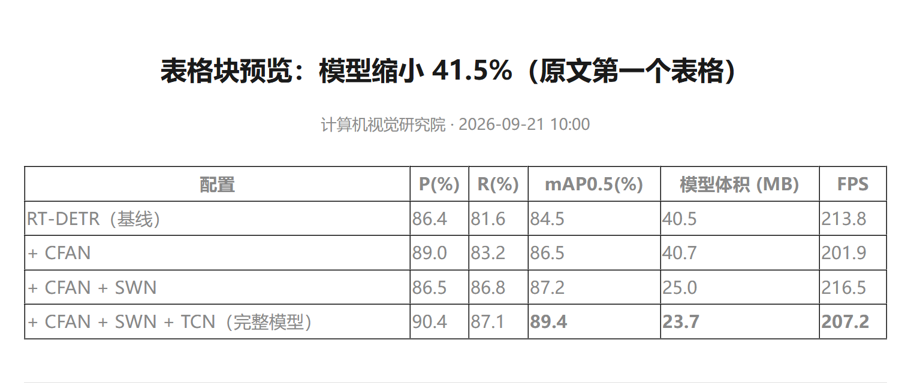

# M1 记录：单篇/多篇 URL → Word 已跑通（2026-10-19）

> 状态：**M1 完成**。`w2d export <url>` 能把公众号文章变成保留文字与图片排版的 docx，图片全部内嵌。
> 前置：[05-探针结论](./05-探针结论.md)（Word COM 已否决，只用 python-docx）
> 已累计用 **4 篇真实文章**验证（见文末「第二轮样本」）。

---

## 一、真实样本验证结果

用你给的两篇文章跑通端到端：

| 文章 | 字数 | 块 | 图片 | 表格 | docx 大小 | 耗时（抓取/解析/下图/渲染） |
|---|---|---|---|---|---|---|
| 【TGRS】KunPeng（海科快跑） | 6,191 → 7,721 | 70（38 段 + 21 标题 + 6 图 + 5 列表） | **6 / 6 成功** | 0 | 2.79 MB | 3.1s / 43ms / 2.1s / 257ms |
| TGRS 2026 EDSEL（深度学习爱好者） | 3,341 → 3,633 | 54 | **14 / 14 成功** | 0 | 2.43 MB | 2.7s / 44ms / 2.3s / 274ms |

> 字数两次统计不同，是因为后来修了 `chars` 统计口径（原来没算列表项、表格单元格、图注，见第四节第 6 条）。

**逐项验收**

| 验收项 | 结果 | 证据 |
|---|---|---|
| 文字无缺失、无乱码 | ✅ | 两篇正文全部落到 docx，`article.json` 里有逐步记录 |
| 图片内嵌（断网可看） | ✅ | docx 内 `word/media/` 有 6 / 13 个图片文件；`inline_image_count` 一致 |
| 图片顺序与原文一致 | ✅ | 用 mammoth 把 docx 反解成 HTML 截图比对，图文顺序正确 |
| 标题层级可导航 | ✅ | 用了真正的 `Heading 2/3` 样式（Word 导航窗格与自动目录可用） |
| 中文不跳宋体 | ✅ | `w:rFonts` 三属性齐写 |
| 保留原文配色 | ✅ | 例如 EDSEL 那篇小标题 `#2584b5`、「深度学习爱好者」`#0080ff` 均为原文自带色 |
| OOXML 结构合法 | ✅ | `office_document validate` → `valid: true`（唯一 warning 是结尾的原文外链，预期行为） |
| 发布时间正确 | ✅ | `2026-10-08 00:06` / `2026-10-11 19:00`，来自 `var ct = "…"` 时间戳 |

---

## 二、这一轮踩到并修掉的 4 个真实坑

1. **发布时间取不到**
   `#publish_time` 是个空 `<em>`，真实时间在 `var ct = "1791389162"` 里。
   修 `_var_value` 时发现 f-string 里的正则量词 `{1,200}` 没转义，被 Python 当成格式字段 → 正则失效。已写成 `{{1,200}}` 并加注释。

2. **整篇图片全丢（14 张只剩 0 张）**
   PDF/微信的图片结构是 `<section><figure><span leaf></span></figure></section>`。
   我原先的「是否有块级子节点」只检查**直接子节点**，被中间的 `<span>` 骗过去，图片被当行内内容丢弃。
   改为检查**整棵子树**（`_contains_block`），并给 `figure` 单独处理：`` + `<figcaption>` 合成一个带图注的 image block。

3. **小标题用普通段落，导航窗格拿不到**
   改成真正的 `Heading 1/2/3` 样式，再在 run 层覆盖字号与颜色，兼顾「结构可导航」与「配色忠实原文」。

4. **`RGBColor` 被当作 hex 字符串传给 `_set_font`**
   让 `_set_font` 同时接受 `RGBColor` 与 `"2584b5"` 两种形式。

5. **幂等彻底失效（每次重跑）**
   原设计用「整页 HTML 的 sha256」判断「同一篇是否已导出」。但公众号页面**每次请求都带随机 nonce / 时间戳**，整页哈希必然不同 → 永远不相等，等于没有幂等。
   改为用**文章身份**（`host + /s/xxxx` 路径）做键，并把 manifest 里已有的产物文件集合与本次请求的格式比对；全部齐备才跳过。实测第二次执行正确输出「跳过」。

---

## 三、代码结构（当前实况）

```
src/w2d/
├─ model.py        Article / Block / Run / Asset 数据模型（blocks[] 是唯一中间表示）
├─ fetcher.py      URL 白名单、直连抓取、风控页/删文页识别（给人话提示）
├─ parser.py       ★ 元数据提取 + section 递归压平 + 节点→blocks（改版只改这里的选择器）
├─ assets.py       图片白名单下载、Referer 双策略、webp→png、sha1 记录
├─ render.py       docx（python-docx）+ html（离线单文件，图片 base64）
├─ pipeline.py     编排、目录命名、幂等跳过、manifest.json
└─ cli.py          w2d export / serve
```

**关键工程点**
- 图片域名白名单（`mmbiz.qpic.cn` 等）：不当通用下载器用
- 抓微信强制直连：`trust_env=False` + 清空 `*_PROXY`（走境外代理更易触发风控）
- 幂等：按**文章身份**（`host + /s/xxxx`）判断，已有完整产物即 `skipped`，`--force` 强制重跑
- 产物可审计：`manifest.json` 记文章身份、HTML 哈希、每个产物的 sha256、图片清单、耗时、告警

---

## 四、已知限制（诚实清单）

| 限制 | 现状 | 计划 |
|---|---|---|
| 背景图卡片（真带 `url(...)` 的） | 降级为文字块，`warnings` 里有计数 | M2：Chrome 无头截图转图片插入 |
| 表格 | ✅ 已在第五篇验证（5×6，表头加粗淡底 + 斑马纹 + 边框）；带 `<th>` 的表格样本还没遇到 | — |
| 视频/音频 | 目前可能整块丢失 | M2：降级为「说明文字 + 原文链接」 |
| 内联 SVG 图标 | 未删除（4 篇都没有） | M2 清理 |
| 图片体积 | 原图直存：普通图文 0.8–2.8 MB；**带 6 张 GIF 的那篇到了 7.7 MB** | M2 加 `--compress` 档（GIF 转静态 PNG / 长边限制），并给「文件过大」提示 |
| Word 视觉版式 | **未用 Word 真实渲染验证过**（Word COM 在本机会挂死，已放弃） | 需要你打开看一眼；如果排版有出入，把截图发我 |
| 抓取耗时波动大 | 同一批样本 2.7s–48s 不等（页面 3.5–4.2 MB） | M2 查：可能是服务端限速，考虑 keep-alive / 重试 / 超时分级 |
| 仅支持单篇/多篇 URL | 合集页（`appmsgalbum`）、本地工作台 | M2 / M3 |

---

## 五、第二轮样本（M1.1，2026-10-19 追加）

你补充的两篇文章：ADAPT-Tracker（视觉语言导航）、FAME-Net（AIPapersDaily）。这两篇暴露了 5 个之前没被覆盖的 bug，**全部已修**。

| 文章 | 块 | 图片 | 字数 | docx |
|---|---|---|---|---|
| ISPRS-2026 ADAPT‑Tracker | 64 | **8 / 8** | 3,970 | 773 KB |
| TGRS 2026 FAME‑Net | 41 | **7 / 7** | 3,412 | 1,484 KB |

四篇样本现在的完整性：

| 样本 | HTML 里 `` | 输出 image block | 结论 |
|---|---|---|---|
| KunPeng | 6 | 6 | ✅ |
| EDSEL | 14 | 14 | ✅（修复前只有 13） |
| ADAPT‑Tracker | 8 | 8 | ✅（修复前只有 6） |
| FAME‑Net | 7 | 7 | ✅（修复前只有 5） |

### 这轮修掉的 5 个 bug

6. **`background-image: none` 被误判成「背景图卡片」**
   判断写成 `"background-image" in style`，而公众号页面到处是 `background-image: none`。ADAPT‑Tracker 有 **70 个节点**被误判，导致这些节点被降级成方块文字、还生成 70 条假告警。
   改为只在真有 `url(...)` 时才算卡片，并顺便处理「卡片里没文字就把背景图本身当图片」的情况。

7. **公众号名片 `mp-common-profile` 整块丢失**
   名片的可见文字为空，信息全在 `data-nickname` / `data-alias` / `data-signature` 属性里。现在渲染成一条引用块：`【公众号名片】AIPapersDaily`。

8. **`<span>` 包裹的图片被当行内内容丢掉**（影响最大）
   结构是 `<p>文字<span leaf></span>图注</p>` 或 `<section><span></span></section>`。
   原来容器分支只判断 `tag in {section, div, p, ...}`，中间的 `<span>` 不在名单里，于是走了行内分支、图片被跳过。
   改为：**只要子树里有块级内容就递归**（不再按标签白名单），这一条同时解释了为什么 EDSEL 那篇少 1 张图。

9. **`<ol><li>` 里的图片丢失**
   列表分支只取 `li` 的行内文字。现在含图片的列表项会：文字仍作列表项，图片按原顺序紧跟其后。

10. **图注重复**（alt 与原文自带图注各来一遍）
    图片的 `alt`（如「图1 不同红外场景下的目标与背景特性差异」）与原文正文里自带的「中心图1 不同红外场景下目标和背景的特点差异」重复。
    在最终 blocks 上做了去重：只有当后文出现**短句**（≤ max(40, 图注标题长×3)）且包含图注标题前 6 字时才去掉 alt 图注 —— 这样「如图4所示」这种正文引用不会被误判。

11. **`chars` 统计口径错**（不是内容 bug，但会误导验收）
    字数只累加了 `block.runs`，没算列表项 `items`、表格 `rows`、图注。ADAPT‑Tracker 因此显示 1,876 字，实际 3,970 字。已修。

---

## 六、第三轮样本：表格终于验证了（M1.2）

第五篇：`模型缩小 41.5%，精度反超 4.9%！这个红外小目标检测新架构太能打了`（计算机视觉研究院）。

这是**第一篇带真表格、且结构最极端**的样本：155 个 `<section>`（嵌套深 16 层）、18 张图里 6 张是 GIF、多个 `<ol>`。

| 指标 | 结果 |
|---|---|
| 块 | 108（64 段 + 18 图 + 17 列表 + 7 标题 + 1 引用 + **1 表格**） |
| 图片 | 18 个 image block / 17 个资源（2 个 block 指向同一 URL，去重后 17） |
| 表格 | **5 行 × 6 列**，内容与原文一致 |
| 字数 | 3,781 |
| 耗时 | 抓取 0.7–4.9s / 解析 53ms / 下图 3.0s / 渲染 823ms |
| OOXML | 结构合法 |

**表格做得对不对（结构级证据）**：

```
样式: Table Grid | 5 x 6
header cell='配置'   fill=F2F2F2 bold=True
header cell='P(%)'   fill=F2F2F2 bold=True
body   cell='RT-DETR（基线）' fill=None
```



### 这轮的两处改动

12. **表头推断（保守）**
    这张表原文**完全没有表头样式**：全部是 `<td>`、无加粗、无底色。所以 `header_rows=0` 是忠实的，但读起来很难分辨列头。
    加了推断规则：**首行没有纯数字单元格、而下面某行有** → 认定首行为表头，此时只**加粗 + 淡灰底（F2F2F2）**，绝不伪造原文没有的深蓝配色；只有原文真有 `<th>`/`<thead>` 时才用深底白字。

13. **GIF 提示**
    这篇 6 张图是动图（`mmbiz_gif`）。Word 只显示首帧，现在会在 `warnings` 里明说：
    「6 张 GIF 动图在 Word 里只会显示首帧（文件仍是原 GIF，可用 `--pdf` 看动效）」。

顺带确认：抓取耗时波动（0.7s ~ 48s）来自服务端限速，不是本地问题；同一篇重试时快时慢。

---

## 七、下一步

**M2（批量与兜底）** 建议顺序：
1. 卡片转图 + 视频/音频降级 + SVG 清理（补齐内容完整性）
2. 抓取性能与稳定性（耗时 0.7s–48s 波动、失败重试、超时分级）
3. 合集页解析、`--url-file` 批量实测
4. 图片压缩档位

**需要你做的两件事**
1. **打开这几份 docx 看一眼**（图片大小、行距、标题层级、表格边框），有问题直接说。
2. 已经覆盖：单篇/多篇、6~18 图、表格、GIF、公众号名片、极端嵌套（155 个 section）。
   仍缺的样本：**背景图卡片**（真带 `background-image:url(...)`）、**视频/音频/小程序卡片**、带 `<th>` 的表格。

---

# M2 记录：卡片截图 / 媒体降级 / 压缩 / 批量（2026-10-20）

> 状态：**M2 完成**。新增能力全部有测试或实测证据；16 个单元测试全绿。

## 一、M2 做了什么

| 能力 | 实现 | 验证方式 |
|---|---|---|
| **背景图卡片转图** | `src/w2d/shot.py`：把卡片 HTML 片段交给本机 Chrome 无头渲染成 PNG（375px 宽、2x 缩放），再裁掉空白、当图片插入 | 合成样本 → 2/2 截图成功；直接调用测试产出 43 KB PNG |
| **视频/音频/小程序降级** | `MEDIA_TAGS` 统一映射为 `media` block：`【视频】标题（媒体内容未下载，请在原文查看）`，有链接就附上 | 合成样本断言 3 个媒体块 |
| **内联 SVG / data:svg 图标清理** | `SKIP_TAGS` 丢弃 `<svg>`，`data:image/svg+xml` 的 img 直接跳过，并在 warnings 里报数量 | 合成样本断言（1 个 svg + 1 个 data-icon） |
| **抓取重试与超时分级** | 连接 15s / 读取 90s；网络类失败重试 2 次（1.5s、3s 退避）；5xx 与「内容过短」也重试 | 实测 5 篇批量全部成功 |
| **批量 / URL 文件** | `--url-file` 每行一个 URL，支持 `#` 注释 | 实测 5 篇：全部跳过（幂等）、退出码 0 |
| **合集页入口** | `w2d links <page-url>`：从页面提取 `mp.weixin.qq.com/s?...` 链接，可写入文件再喂给 `--url-file` | 已实现；**未在真实合集页验证**（见限制） |
| **图片压缩档** | `--compress`：GIF/webp 转静态图、长边超限缩放、>400KB 无 alpha 的 PNG 转 JPEG(q85) | 实测：10 张图 6.47 MB → 0.87 MB，**docx 7.34 MB → 1.75 MB（省 76%）** |
| **体积提示** | docx > 8 MB 时提示可加 `--compress` | 已验证触发逻辑 |
| **回归测试** | `tests/test_parser.py` + `tests/fixtures/edge.html`（合成样本，覆盖 15 类边界结构） | **16 个用例全绿** |

## 二、这轮修掉的 6 个 bug

14. **`mpvoice` 在 `SKIP_TAGS` 里** → 音频整块消失。媒体类标签从 SKIP 移出，交给 `MEDIA_TAGS` 降级；同时让媒体标签参与「容器是否要继续下钻」的判断。
15. **Chrome 无头报 `Missing headless user data directory`** → 新版 headless 必须显式 `--user-data-dir`，否则默认 profile 目录不可写就退出。
16. **Chrome 把相对路径当成安装目录** → `--screenshot=` 与 `--user-data-dir=` 必须传**绝对路径**，否则截图静默失败。
17. **跨天重跑生成重复目录** → 目录名里带的是**导出日期**，第二天再跑就新建一份。改为用**文章发布日期**，并把幂等判断改成「按文章身份扫描输出目录」，不再依赖目录名。
18. **`--url-file` 首行失败** → PowerShell 的 `Set-Content -Encoding UTF8` 会写 BOM，首行变成 `\ufeffhttps://...`。读取改用 `utf-8-sig`。
19. **压缩档完全没生效且留下 0 字节文件** → Pillow 13 已移除 `Image.LANCZOS`，异常被 `except` 吞掉且没清理半截目标文件。改用 `Image.Resampling.LANCZOS`，并在失败时清理残留；另加「孤儿图片清理」（重跑换格式后旧文件不会堆积）。

顺带修：压缩日志里的 `//1024` 把 922 字节显示成「0KB」，改为汇总一条并保留两位小数。

## 三、M2 后的能力边界

```
w2d export <url>...            单篇/多篇
w2d export --url-file urls.txt 批量
w2d export --input-html saved.html --source-url <url>   无网兜底
w2d export --compress          压缩（GIF 转静态、PNG→JPEG、长边限制）
w2d export --no-screenshot     关掉卡片截图
w2d links <page-url>           从页面提取文章链接（合集页入口）
```

## 四、仍然没验证 / 没做的

| 项 | 现状 |
|---|---|
| 真实背景图卡片 | 只有合成样本验证过；五篇真实文章里没有真带 `url(...)` 的卡片 |
| 真实合集页（appmsgalbum） | `links` 已实现，但合集列表常由 JS 渲染，HTML 里可能没有链接 → 属 best-effort，未实测 |
| 视频/音频真实样本 | 只有合成样本 |
| 本地 Web 工作台 | M3 |
| 图片去重 | 同一 URL 只下载一次，但相同内容不同 URL 不合并（影响不大） |
